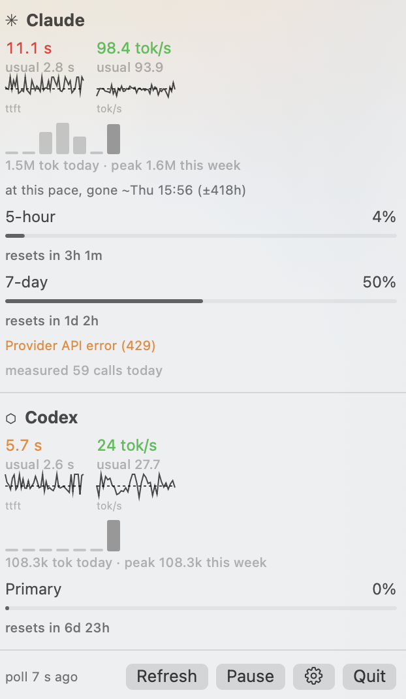

# Semafor



A macOS menu bar app that tells you what your frontier model subscriptions
are actually doing, as opposed to what their status pages say.

Status dashboards for frontier models are useless for this. They go red only
when a whole region is down. They don't know you're at 94% of a 5-hour
window, that your usually-fast session is crawling at 9 tok/s, or that
you're two prompts from a rate limit. Semafor shows all of it, from your own
traffic, in the corner of the screen.

## What you get

- Menu bar glyph tinted by the worst state across providers. Popover with
  per-provider usage windows, reset countdowns, and a burn-rate headline:
  "at this pace, gone ~Thu 02:40 (±284h)".
- Verdicts (OK, Busy, Limited, Degraded, Crawling, Unknown) learned from
  your own history: baselines segmented by provider, model, weekday and time
  band, z-scored against their MAD. The "usual" next to every number is
  yours, not a hard-coded threshold.
- Tiles for measured time-to-first-token and tokens/sec, each stamped with
  how old that measurement is. 7-day bars for tokens/day.
- A banner when the official status page says all clear and your own calls
  say otherwise.
- Your local Qwen box (vLLM, driven by OpenCode): health probe, passive
  throughput samples, and recent 429/5xx errors surfaced where you'll see
  them.

## How it measures

Passive. Claude Code, Codex and OpenCode already write session logs and a
session database as you work. Semafor reads them and derives latency,
throughput and token counts. No extra model calls, no quota spent. Usage
windows come from each provider's own usage endpoint using the credentials
their CLI already keeps on this machine (Keychain for Claude, `auth.json`
for Codex). The only thing that leaves the machine is the provider endpoint
call itself, plus two public robots.txt fetches that tell apart "their
server is slow" from "your network is slow".

## Privacy

Everything stays on your Mac. Credentials are read to call the provider
endpoints and are never stored or logged. Conversation text in the session
logs is parsed for numeric fields and discarded. No telemetry, no accounts,
no server component.

## Stack

Swift 6, SwiftUI `MenuBarExtra`, zero third-party dependencies (Apple system
libs only), macOS 14+. Swift Testing for the suite.

```sh
just build    # swift build
just test     # swift test
just package  # universal .app + DMG into dist/
```

## Status

0.2.x, in daily use. The `main` branch is the stable line; `feat/*` carries
current work. Design docs live in `docs/superpowers/specs/`, implementation
plans in `docs/superpowers/plans/`.
